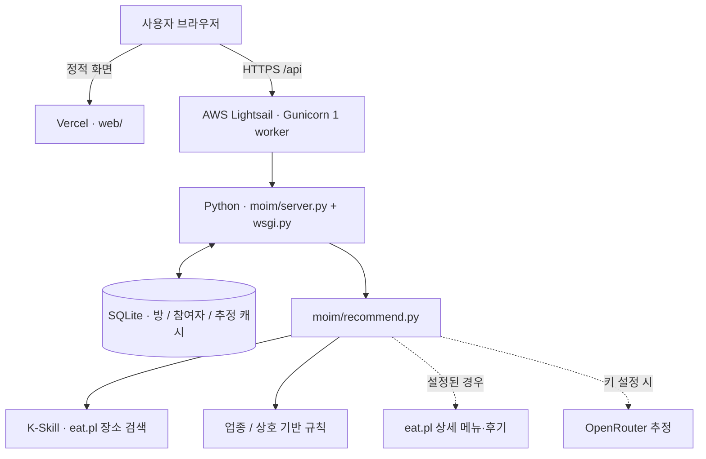

# 시스템 구조 및 API

## 1. 전체 구조

브라우저의 화면 코드는 `web/`, API는 `moim/`의 Python 코드입니다. 프론트는 React/Streamlit이 아니라 정적 HTML·JavaScript이며, 운영 환경에서 Vercel과 API 서버의 출처가 다릅니다. 로컬에서는 Python 서버 하나로 화면/API를 제공할 수 있습니다.

## 2. 소스 디렉터리

| 위치 | 책임 |
| --- | --- |
| `web/index.html`, `web/room.html` | 첫 화면·모임 링크 진입점 |
| `web/v2-landing.js`, `web/v2.js`, `web/v2.css` | 6단계 화면, 클라이언트 상태, 선택·결과 UI |
| `moim/server.py` | 요청 라우팅, 모임·참여자 API |
| `moim/wsgi.py` | 운영 호스트·CORS·HTTP 보안 검증 |
| `moim/options.py` | 선택지와 입력값 검증 |
| `moim/store.py` | SQLite CRUD, 참가자·방장 토큰, AI 캐시 |
| `moim/regions.py`, `moim/stations.py` | 지역 별칭·주소·역 주변 후보 |
| `moim/eatpl.py` | K-Skill 응답 검증 및 샘플 가게 |
| `moim/estimate.py`, `moim/details.py` | 업종 규칙, 선택적인 AI/상세정보 처리 |
| `moim/recommend.py` | 선호 집계·안전 제외·정렬·추천 |
| `deploy/` | 서버 실행 파일·읽기 전용 배포 점검 |
| `tests/` | 단위·API·브라우저 검증 |

## 3. 주요 HTTP API

| 메서드·경로 | 용도 |
| --- | --- |
| `GET /api/options` | 선택지·데이터 소스·공개 가능한 공유용 설정 |
| `POST /api/regions/check` | 동네/역 입력 검증 |
| `POST /api/rooms` | 방 만들기; 방장 토큰 반환 |
| `GET /api/rooms/{id}` | 방 정보와 집계 확인 |
| `POST /api/rooms/{id}/participants` | 참여 조건 등록 |
| `PUT /api/rooms/{id}/participants/{pid}` | 참가자 수정 토큰으로 조건 변경 |
| `DELETE /api/rooms/{id}/participants/{pid}` | 참가자 응답 삭제 |
| `POST /api/rooms/{id}/recommend` | 집계 기반 추천 요청 |
| `DELETE /api/rooms/{id}` | 방장 토큰으로 방 삭제 |

전체 요청/응답 필드는 `moim/server.py`의 `App.handle`과 `moim/options.py`의 입력 검증을 기준으로 합니다. 권한 없는 참가자 수정·방 삭제는 허용되지 않습니다. 초대 링크 자체는 읽기 접근 인증 수단이 아닙니다.

## 4. 데이터 생명주기

1. 브라우저가 방을 만들거나 참여하면 서버에서 입력을 검증합니다.
2. SQLite에 방/참여자 상태가 저장됩니다.
3. 추천 요청 시 현재 참여자 선택을 다시 집계하고 지역·업종 후보를 수집합니다.
4. 고위험 알레르기 후보를 제외한 뒤 [추천 규칙](recommendation.md)으로 정렬합니다.
5. 상세 조회나 AI 추정이 늦으면 현재 근거로 먼저 응답하고, 이후 폴링에서 변화가 있을 때 결과 영역만 갱신합니다.

## 5. 안전·운영 경계

- `OPENROUTER_API_KEY`와 `KAKAO_REST_API_KEY`는 서버 전용. `KAKAO_JS_KEY`는 브라우저 공유 SDK에 쓰므로 공개될 수 있습니다.
- 참가자 수정·방장 토큰은 브라우저 저장소에 보관됩니다. 유출되면 권한이 악용될 수 있어 로그·문서에 기록하지 않습니다.
- 운영 DB와 서버 환경변수는 Git 저장소 밖에서 관리합니다.
- AWS의 현재 실행 버전은 **GitHub `main` 커밋만으로 확인할 수 없습니다.** 서버 SHA를 별도 확인하세요.
